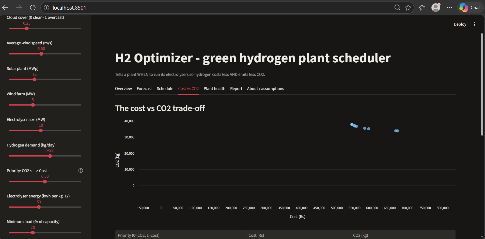

# H2 Optimizer — Green Hydrogen Electrolyser Scheduler

**Live App:** [https://your-name-h2-optimizer.streamlit.app](https://h2-optimizer-ltjei4qrjnihuebve8xf25.streamlit.app) *(replace with your Streamlit Community Cloud URL after deployment)*

> **Honesty Statement:** All weather, plant, tariff, and grid emission data in this prototype are simulated; the forecasting and MILP optimisation pipeline is structured to plug directly into real plant SCADA and day-ahead grid feeds.

---

## 1. Problem
Green hydrogen production is electricity-intensive (~50–55 kWh per kg of $\text{H}_2$). Running electrolysers at a constant 24/7 flat load forces the plant to draw expensive, high-carbon grid power during peak thermal hours while underutilising midday solar and evening wind generation.

## 2. Solution
**H2 Optimizer** is an interactive decision-support web application that tells a green hydrogen plant **when** to run its electrolysers over the next 24 hours:
1. **Forecasting (`forecast.py`):** Two Gradient Boosting regressors (`scikit-learn`) predict hourly solar and wind capacity factors from hour of day, cloud cover, and wind speed.
2. **Optimisation (`optimizer.py`):** A Mixed-Integer Linear Programming (`scipy.optimize.milp`) engine schedules hourly electrolyser power, renewable allocation, and stack on/off commitment subject to daily $\text{H}_2$ demand, minimum load, maximum capacity, and hourly ramp-rate constraints.
3. **Cost vs. $\text{CO}_2$ Control (`app.py`):** Operators adjust a priority weight $w \in [0, 1]$ to balance operating cost against carbon emissions and benchmark performance against a flat 24/7 baseline.

## 3. Key Features
* **7-Tab Interactive Dashboard:** `Overview`, `Forecast`, `Schedule`, `Cost vs CO2`, `Plant health`, `Report`, and `About / assumptions`.
* **Real-Time What-If Simulation:** Sidebar sliders for cloud cover, wind speed, solar/wind plant capacity, electrolyser rating, daily $\text{H}_2$ target, specific energy consumption (kWh/kg), minimum load, and cost-vs-$\text{CO}_2$ priority.
* **Plain-Language Schedule Explanations:** Summarises active operating hours, peak renewable dispatch windows, and grid power usage.
* **Plant Health Interlocks:** Simulates feed-water conductivity ($\mu\text{S/cm}$) startup blocking, purified tank level delays, and stack temperature/efficiency alerts.
* **Manufacturer Daily Report:** Generates an hourly dispatch table with one-click CSV download (`h2_daily_report.csv`).

## 4. Tech Stack
* **Language:** Python 3.10+
* **Frontend & Hosting:** Streamlit, Streamlit Community Cloud
* **Machine Learning:** scikit-learn (`GradientBoostingRegressor`)
* **Mathematical Optimisation:** SciPy (`scipy.optimize.milp`)
* **Data Processing:** NumPy, pandas

## 5. How to Run Locally
```bash
# 1. Clone or open the project folder
cd h2-optimizer

# 2. Create and activate a virtual environment
python -m venv venv
venv\Scripts\activate        # Windows
# source venv/bin/activate   # macOS / Linux

# 3. Install dependencies
pip install -r requirements.txt

# 4. Launch the Streamlit app
python -m streamlit run app.py
```

## 6. Results (Simulated Benchmarks)
* **Forecast Model Accuracy (Held-out 20% test split):** Solar MAE $\approx 1.7\%$ of capacity; Wind MAE $\approx 2.3\%$ of capacity.
* **3-Day Schedule Comparison** *(12 MWp solar, 5 MW wind, 10 MW electrolyser, 2,500 kg $\text{H}_2$/day, balanced $w = 0.5$, simulated data)*:

| Weather Scenario | 24/7 Cost (Rs) | 24/7 $\text{CO}_2$ (kg) | Balanced Cost (Rs) | Balanced $\text{CO}_2$ (kg) | Cost Saved | $\text{CO}_2$ Saved |
| :--- | :---: | :---: | :---: | :---: | :---: | :---: |
| **Sunny, calm** | 724,350 | 60,180 | 534,514 | 35,844 | **26%** | **40%** |
| **Partly cloudy, breezy** | 707,460 | 57,036 | 557,339 | 36,542 | **21%** | **36%** |
| **Overcast, windy (monsoon)** | 677,985 | 50,894 | 568,241 | 35,279 | **16%** | **31%** |

### Cost vs. $\text{CO}_2$ Trade-Off Curve


> **Key Insight:** Renewable generation lowers both cost and $\text{CO}_2$ simultaneously; the cost-versus-carbon trade-off appears only during grid-dependent hours when cheap off-peak thermal power competes with cleaner midday grid hours.

## 7. Assumptions & Engineering References
* **Electrolyser Specific Energy:** Configurable between 48–60 kWh/kg $\text{H}_2$ (default calibrated around 52–53 kWh/kg for industrial alkaline stacks; reference range: IRENA / MNRE National Green Hydrogen Mission benchmarks).
* **Operational Constraints:** Minimum stable load of 20% capacity when active, maximum hourly ramp rate of 50% capacity, and ~11.7 L purified water demand per kg $\text{H}_2$ (stoichiometric + purification losses, conductivity limit $< 1.0\ \mu\text{S/cm}$).
* **Tariff & Grid Emissions:** Illustrative 24-hour Time-of-Day industrial tariff curve and hourly grid emission factor ($\text{kg CO}_2/\text{kWh}$) inspired by Tamil Nadu (TNERC/TANGEDCO) ToD windows and CEA Indian power sector $\text{CO}_2$ baseline ranges.
* **Captive Renewable Cost:** Assumed at Rs 3.6/kWh with zero operational $\text{CO}_2$ emissions.

## 8. Limitations & Future Work
* **Current Limitations:** Uses synthetic weather and illustrative tariff/emission profiles rather than live SCADA feeds; models a single plant and single 24-hour horizon with aggregate daily $\text{H}_2$ demand, no compressed $\text{H}_2$ buffer storage, and rule-based health thresholds.
* **Future Work:** Live weather API integration (e.g., Open-Meteo for Coimbatore), real-time SCADA and day-ahead power exchange pricing, compressed hydrogen storage & compressor scheduling, stack degradation cost modeling, and multi-plant portfolio dispatch.
